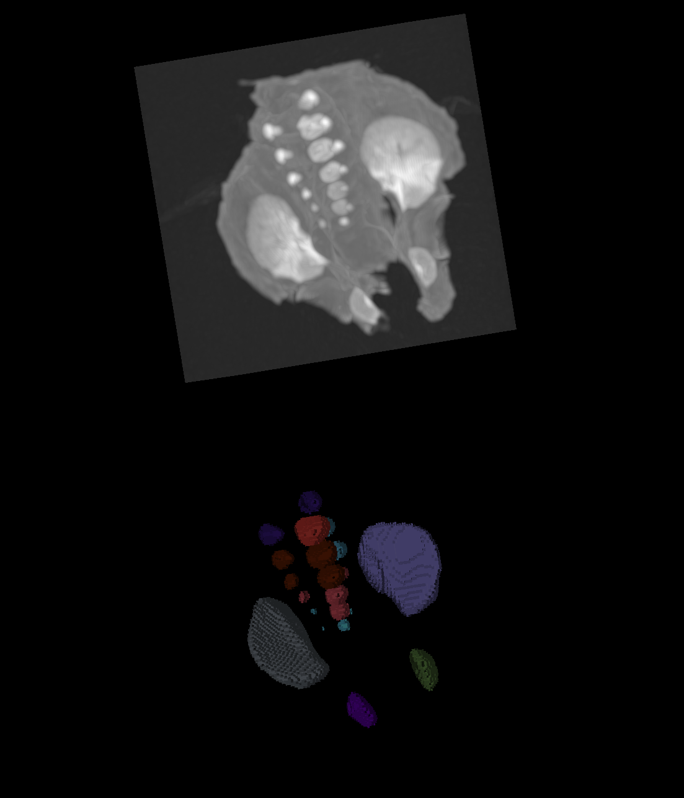
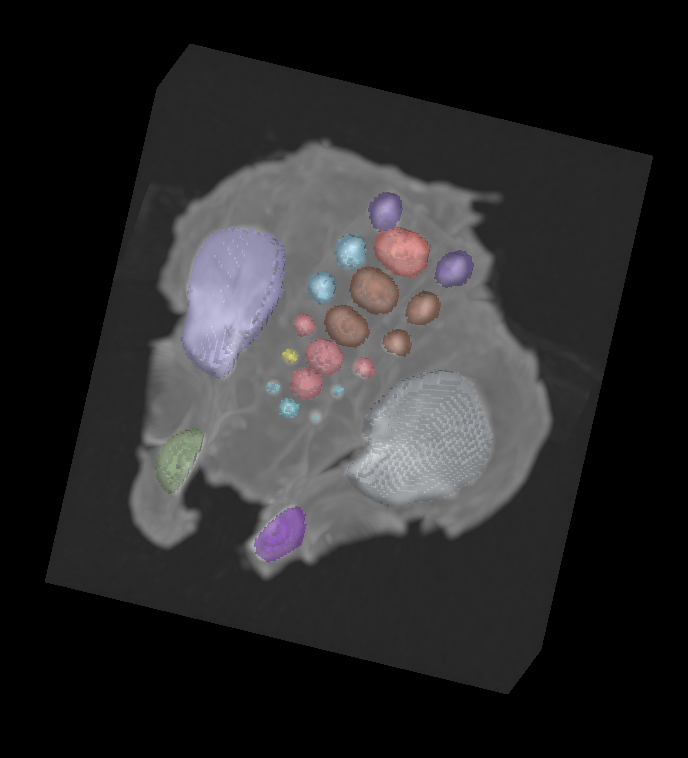
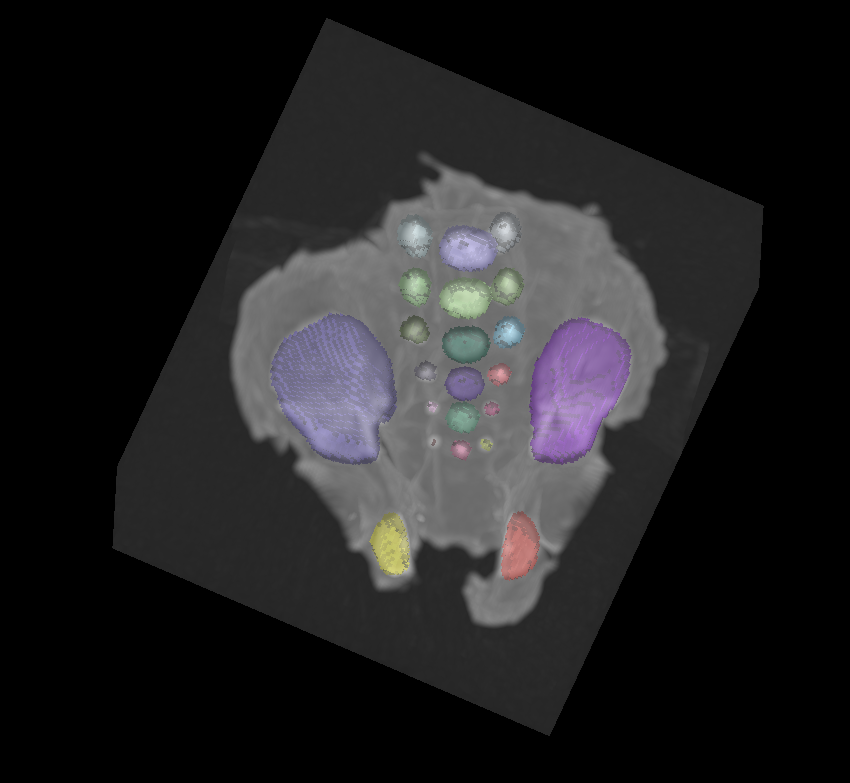
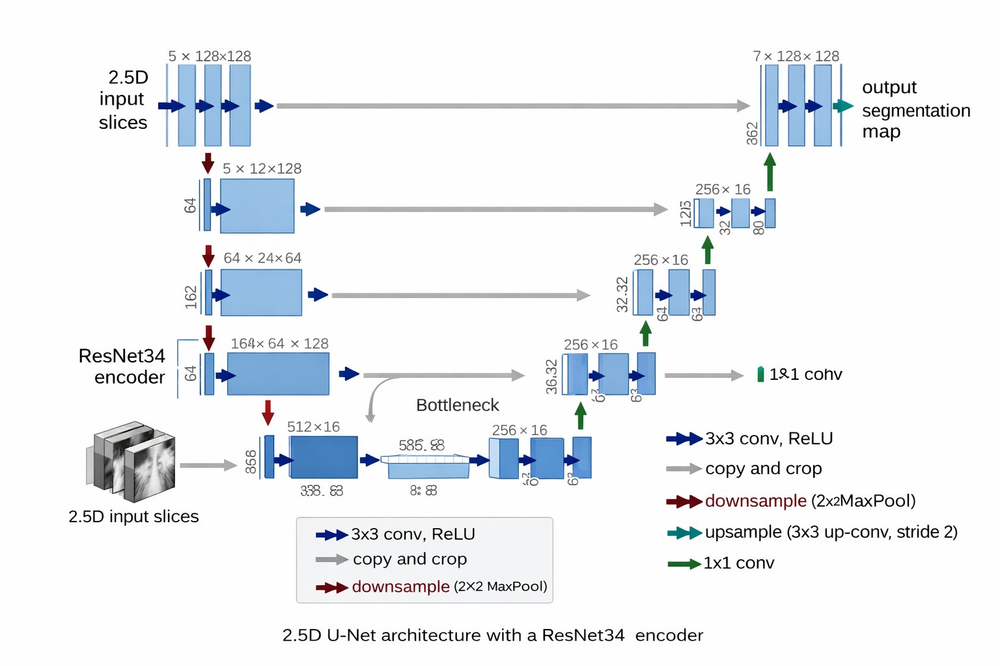

# Fetal Ossification Centers: CT Data Engineering and Segmentation

A research project on fetal ossification center segmentation from volumetric CT scans. The work started with a data problem: raw volumes, compressed segmentation masks and metadata needed to be reconstructed, matched and checked before any model could be trained.

**[Interactive technical report](https://ctproject-99mdzcfenjeyamtnqpqypg.streamlit.app/)** · **[Source code](https://github.com/Mayk-ITdS/CT_project)**

**Topics:** medical imaging, data reconstruction, 3D spatial analysis, data preparation, 2.5D segmentation, PyTorch, CNNs.



## At a glance

| | |
|---|---|
| Research question | How can tiny and irregular fetal ossification centers be segmented from scarce volumetric CT data? |
| Input | Raw CT volumes, segmentation masks and heterogeneous metadata |
| Main engineering work | File reconstruction, CT/mask alignment, mask decoding, connected-component analysis, ROI extraction and 2.5D dataset preparation |
| Modeling | CNN-based semantic segmentation (U-Net with ResNet34 encoder in the checked evaluation code) |
| Reported results | Mean Dice **0.69**, median Dice **0.72**, **19,980** evaluated samples |
| Scope | Research experiment; not a clinically validated diagnostic system |

The results are taken from the accompanying technical report. The number of evaluated samples must not be confused with the number of independent patients or CT volumes.

## 1. Research context and problem

Fetal CT data is rare and difficult to access because of clinical and ethical constraints. The anatomical structures of interest are very small, irregular, variable across development and often difficult to distinguish from surrounding tissues.

This creates several problems at once:

- Very limited data, sometimes originating from non-standard clinical cases.
- Large 3D volumes with extremely sparse target structures.
- Differences in anatomy, size and appearance between cases.
- Changes in the visible structures across adjacent slices.
- Complex preprocessing before meaningful training becomes possible.

The full research-context infographic is provided separately for addition to `docs/images/research-context.png`. The text and real screenshots here remain useful even before that asset is committed. The estimated fraction of occupied CT voxels shown in the infographic should be treated as dataset-specific, not as a general clinical constant.

## 2. From source files to aligned CT volumes and masks

The dataset did not arrive as a conventional collection of ready-to-train images. The source includes raw `.rdata` volumes, header files with volume dimensions, and segmentation representations such as `.maskSet` and `.voxelizedSurfaces`.

The reconstruction work involves:

1. Inspecting the file structure and mapping samples to the corresponding volume and mask.
2. Reading dimensions from headers.
3. Reconstructing volumes with explicit `(Z, Y, X)` ordering.
4. Decoding compressed masks where necessary.
5. Checking that reconstructed CT arrays and masks have matching shapes.
6. Collecting metadata needed for subsequent analysis and dataset generation.

The repository includes reconstruction and validation-related code in `src/Extract/`, `src/Factory/MaskRebuilder/` and `src/Factory/dataset/`.




## 3. Exploratory and structural analysis

This stage focuses on the data rather than the model. The analyses documented in the report include CT intensity distributions, mask coverage, anatomical labels, connected components and spatial distributions.

Connected components provide features such as component size, centroid, bounding box and normalized location. Grouping these components helps explore the structural consistency of annotations and anatomical patterns across cases.

The relevant exploratory code is organized under `src/EDA/` and `src/Factory/MaskRebuilder/`. The Streamlit report includes interactive figures and supporting tables.

## 4. Building a segmentation dataset

The processing pipeline includes ROI extraction, cropped samples, normalization, label remapping and 2.5D representations based on adjacent slices.

A central constraint is class imbalance: most CT voxels belong to the background, while the structures of interest occupy very small regions. A naïve sampling strategy can therefore produce a large number of training samples containing little or no relevant anatomy.

The dataset builder in `src/Factory/dataset/build_dataset.py` contains functions for reading reconstructed volumes and masks, selecting ROIs and exporting cropped tensors with associated metadata.

**Split methodology:** the experiment uses a patient-level split as described by the project author. Train, validation and test samples should contain disjoint patient identifiers. The exact split-generation script and an automated assertion are not currently demonstrated in the files reviewed for this README, so this remains a reproducibility item to document explicitly.

## 5. Model and evaluation

The checked evaluation code in `src/tests/volumes_tests.py` loads a U-Net through `segmentation_models_pytorch` with a ResNet34 encoder, five input channels and seven output classes.

Its evaluation logic includes a Dice computation and per-class analysis. It also shows a combined cross-entropy and Tversky loss formulation.



| Reported metric | Value |
|---|---:|
| Mean Dice | 0.69 |
| Median Dice | 0.72 |
| Evaluated samples | 19,980 |

The reported results come from a single model configuration and should be interpreted as exploratory research results. They do not establish clinical performance or generalization to external cohorts.

**Important reproducibility note:** `src/models/Unet CNN/train.py` is empty in the reviewed repository state. The public repository therefore does **not** currently provide a complete verified training entry point or an end-to-end training reproduction command. This distinction matters and should be resolved before claiming full reproducibility.

## 6. Repository layout

```text
CT_project/
├── report_streamlit/
│   ├── app.py               # interactive research report
│   ├── assets/              # CT images, masks and architecture diagrams
│   └── data/                # prepared tables used by the report
├── src/
│   ├── EDA/                 # exploratory plots and analysis
│   ├── Extract/             # reconstruction/validation utilities
│   ├── Factory/
│   │   ├── MaskRebuilder/  # component analysis and mask reconstruction
│   │   └── dataset/        # 2.5D dataset preparation
│   ├── models/              # model-related work
│   └── tests/               # evaluation utilities
├── .streamlit/
└── requirements.txt
```

## 7. Run the interactive report

The root `requirements.txt` lists the minimal dependencies for the published Streamlit report, not the entire training stack.

```bash
git clone https://github.com/Mayk-ITdS/CT_project.git
cd CT_project

python -m venv .venv
source .venv/bin/activate
pip install -r requirements.txt

streamlit run report_streamlit/app.py
```

On Windows PowerShell, activate the virtual environment with `.venv\Scripts\Activate.ps1`. The report expects its bundled CSVs and images to be present. The commands above describe launching the report, not reproducing model training.

## 8. Limitations and further work

- Only one model configuration has been evaluated in the presented experiment.
- Model performance varies considerably across cases and anatomical structures.
- The limited dataset and extreme imbalance make generalization difficult.
- Split-generation and training reproduction need to be documented in the repository.
- Further studies should compare ROI definitions, sampling strategies, model architectures and spatial contexts.
- Evaluation could be extended to volume-level metrics and boundary-distance metrics such as HD95.

## 9. Responsible use and provenance

This repository describes an experimental research project, not medical advice or diagnostic software. The origin, permissions and redistribution conditions of the underlying CT data should be documented before publishing any additional source volumes or patient-level records.

## Author

Michał Zieliński

[LinkedIn](https://www.linkedin.com/in/michalzielidevelop/) · [GitHub](https://github.com/Mayk-ITdS)
